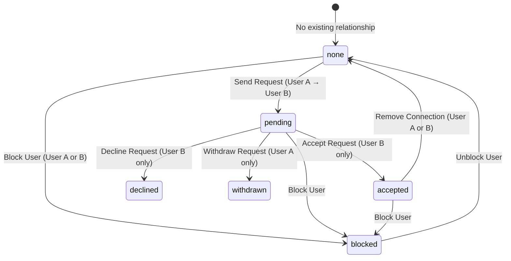

# FR8X — CANONICAL RELATIONSHIP MODEL, SCHEMA & STATE MACHINE
**System:** FR8X B2B Freight Logistics Platform  
**Target:** Connection Requests, Reciprocal Contacts, Notifications, and Distributed Lifecycle  
**Date:** October 19, 2026  
**Status:** AUTHORITATIVE ARCHITECTURAL SPECIFICATION  

---

## 1. Authoritative Relationship State Machine

Every relationship between two users (User A and User B) in FR8X is derived from an authoritative state machine. No individual UI component or cache may infer or invent an independent status.



### Valid Lifecycle State Transitions

| From State | Allowed Transition | Triggering Actor | Authorization Guard | Terminal? | Reconciled Notifications |
|---|---|---|---|---|---|
| `none` | `→ pending` | Requester | `requester_id == session.user.id` AND `requester_id != recipient_id` | No | Creates `connection_request` notification for recipient only. |
| `pending` | `→ accepted` | Recipient | `recipient_id == session.user.id` (Caller MUST be recipient) | Yes | Marks request notification read; creates `connection_accepted` notification for requester. Unlocks mutual contact. |
| `pending` | `→ declined` | Recipient | `recipient_id == session.user.id` | Yes | Marks recipient notification read. |
| `pending` | `→ withdrawn` | Requester | `requester_id == session.user.id` (Caller MUST be requester) | Yes | Marks recipient notification read with description update: *"This connection request was withdrawn by the sender."* |
| `accepted` | `→ none` | Either user | Caller is participant in connection | Yes | Clears mutual contact connection records. |
| Any | `→ blocked` | Either user | Caller is blocker | Yes | Removes active connections, invalidates requests, hides discovery. |

### Forbidden Transitions
- `withdrawn → accepted`: Strictly rejected. Once withdrawn, a request cannot be accepted by a stale client or replayed WebSocket event.
- `declined → accepted`: Strictly rejected.
- `accepted → pending`: Strictly rejected.
- `self → pending`: Check constraint `chk_connection_requests_no_self` and API validation reject self-requests with HTTP 400.

---

## 2. Canonical Database Schema (Dual-Mode Compatibility)

To guarantee zero downtime across environments where remote PostgREST schema updates lag local migrations, the database layer supports both canonical relational models:

### 2.1 Model A: Remote Legacy / Active Supabase Schema (`public.connections`)
```sql
CREATE TABLE IF NOT EXISTS public.connections (
    id TEXT PRIMARY KEY,
    requester_id TEXT NOT NULL REFERENCES public.profiles(id) ON DELETE CASCADE,
    recipient_id TEXT REFERENCES public.profiles(id) ON DELETE CASCADE,
    receiver_id TEXT REFERENCES public.profiles(id) ON DELETE CASCADE,
    status TEXT NOT NULL CHECK (status IN ('pending', 'accepted', 'declined', 'cancelled', 'withdrawn', 'blocked')),
    note TEXT,
    created_at TIMESTAMPTZ NOT NULL DEFAULT timezone('utc'::text, now()),
    updated_at TIMESTAMPTZ NOT NULL DEFAULT timezone('utc'::text, now())
);

CREATE INDEX IF NOT EXISTS idx_connections_requester ON public.connections(requester_id);
CREATE INDEX IF NOT EXISTS idx_connections_recipient ON public.connections(recipient_id);
CREATE INDEX IF NOT EXISTS idx_connections_receiver ON public.connections(receiver_id);
CREATE INDEX IF NOT EXISTS idx_connections_status ON public.connections(status);
```

### 2.2 Model B: Normalized Enterprise Schema (`public.connection_requests` + `public.accepted_connections`)
```sql
CREATE TABLE IF NOT EXISTS public.connection_requests (
    id UUID PRIMARY KEY DEFAULT gen_random_uuid(),
    requester_id UUID NOT NULL REFERENCES public.profiles(id) ON DELETE CASCADE,
    recipient_id UUID NOT NULL REFERENCES public.profiles(id) ON DELETE CASCADE,
    status TEXT NOT NULL CHECK (status IN ('pending', 'accepted', 'declined', 'cancelled')),
    message TEXT,
    created_at TIMESTAMPTZ NOT NULL DEFAULT timezone('utc'::text, now()),
    updated_at TIMESTAMPTZ NOT NULL DEFAULT timezone('utc'::text, now()),
    CONSTRAINT chk_connection_requests_no_self CHECK (requester_id <> recipient_id)
);

CREATE UNIQUE INDEX IF NOT EXISTS idx_connection_requests_pending_unique 
ON public.connection_requests(requester_id, recipient_id) 
WHERE status = 'pending';

CREATE TABLE IF NOT EXISTS public.accepted_connections (
    id UUID PRIMARY KEY DEFAULT gen_random_uuid(),
    user_id UUID NOT NULL REFERENCES public.profiles(id) ON DELETE CASCADE,
    connected_user_id UUID NOT NULL REFERENCES public.profiles(id) ON DELETE CASCADE,
    created_at TIMESTAMPTZ NOT NULL DEFAULT timezone('utc'::text, now()),
    CONSTRAINT chk_accepted_connections_no_self CHECK (user_id <> connected_user_id)
);

CREATE UNIQUE INDEX IF NOT EXISTS idx_accepted_connections_pair_unique 
ON public.accepted_connections (LEAST(user_id, connected_user_id), GREATEST(user_id, connected_user_id));
```

### 2.3 Notifications Schema (`public.notifications`)
```sql
CREATE TABLE IF NOT EXISTS public.notifications (
    id UUID PRIMARY KEY DEFAULT gen_random_uuid(),
    user_id UUID NOT NULL REFERENCES public.profiles(id) ON DELETE CASCADE,
    type TEXT NOT NULL,
    category TEXT NOT NULL DEFAULT 'network',
    title TEXT NOT NULL,
    description TEXT,
    target_url TEXT,
    related_id TEXT,
    read BOOLEAN NOT NULL DEFAULT false,
    metadata JSONB DEFAULT '{}'::jsonb,
    created_at TIMESTAMPTZ NOT NULL DEFAULT timezone('utc'::text, now())
);

CREATE INDEX IF NOT EXISTS idx_notifications_user_read ON public.notifications(user_id, read);
CREATE INDEX IF NOT EXISTS idx_notifications_related_id ON public.notifications(related_id);
```

---

## 3. Distributed-State Consistency Rules
1. **Single Source of Truth:** PostgreSQL is the only authoritative source of connection and notification state.
2. **Deterministic UI Derivations:** The UI queries `/api/people/connections?status=...` and computes:
   - `none` → Render **Connect**
   - `pending_sent` → Render **REQUEST SENT** with **Withdraw**
   - `pending_received` → Render **CONNECTION REQUEST RECEIVED** with **Accept** and **Reject**
   - `connected` → Render **CONNECTED**
3. **Optimistic UI with Rollback:** On user action, optimistic progress states (`SENDING...`, `WITHDRAWING...`, `ACCEPTING...`) provide instant tactile feedback. If the backend returns an error or status mismatch, the UI immediately rolls back to the authoritative state and displays an actionable alert.
4. **Idempotency & Concurrency:** Repeated submissions return the existing active record without generating duplicate requests or phantom notifications. Competing transitions (e.g. concurrent Withdraw vs Accept) resolve deterministically via transactional state checks.
