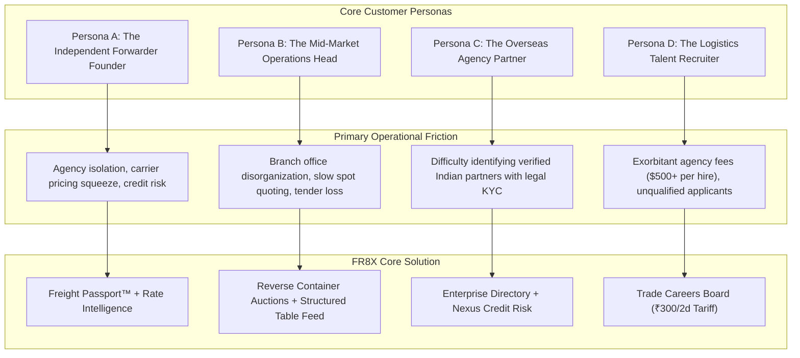

# FR8X — INTERNATIONAL MARKETING STRATEGY & CHANNEL BLUEPRINT
## Complete B2B Go-To-Market Architecture for Global Freight Forwarding Software

> **PURPOSE**: Comprehensive commercial strategy to introduce, position, promote, and sell the FR8X freight platform internationally without requiring prior marketing expertise or massive advertising budgets.

---

# 1. MARKETING FUNDAMENTALS FOR SPECIALIZED FREIGHT TECH

Traditional consumer software marketing (paid Facebook ads, generic Google search ads, viral influencers) completely fails in B2B freight forwarding. Why?
1. **High Inherent Skepticism**: Freight forwarders deal with real cargo worth millions of dollars. They do not trust anonymous software platforms; they trust **verified corporate credentials, personal relationships, and industry recommendations**.
2. **Operational Pragmatism**: A freight forwarder does not buy "AI-powered digital transformation". They buy:
   - *"How can I get a binding rate for 10x40HC from Nhava Sheva to Rotterdam within 30 minutes?"*
   - *"How can I hire an experienced ocean import executive for ₹300 instead of ₹40,000?"*
   - *"How can I be 100% sure this overseas agent in Dubai won't abandon my container and default on demurrage?"*
3. **The 8-Stage B2B Commercial Pipeline**:
   $$\text{Awareness} \longrightarrow \text{Lead Magnet} \longrightarrow \text{Discovery} \longrightarrow \text{Demonstration} \longrightarrow \text{Free Trial} \longrightarrow \text{Value Realization} \longrightarrow \text{Paid Conversion} \longrightarrow \text{Retention \& Expansion}$$

---

# 2. TARGET CUSTOMER PERSONAS & VALUE DRIVERS

### Persona A: The Independent Forwarder Founder (1–15 Employees)
- **Title**: Managing Director, Proprietor, Partner.
- **Geography**: India (Mumbai, Delhi NCR, Chennai, Mundra, Kolkata), UAE (Dubai), Singapore, UK.
- **Daily Pain**: Wasting half their day chasing ocean rates from shipping lines; fear of cargo abandonment by unvetted overseas agents.
- **FR8X Value Hook**: "Statutory Freight Passport verification + instant spot rate benchmarks across 50+ ocean routes."

### Persona B: The Mid-Market Operations & Pricing Head (16–100 Employees)
- **Title**: Head of Ocean Freight, Commercial Pricing Director.
- **Geography**: Global freight hubs.
- **Daily Pain**: Handling 30+ container tenders manually across multiple spreadsheets; carrier quotes rolling over before booking confirmation.
- **FR8X Value Hook**: "Reverse container tender room that locks carrier rates and free time for 48 hours."

### Persona C: The Overseas Agency Partner
- **Title**: Global Agency Development Manager, Overseas Network Director.
- **Geography**: Europe (Hamburg, Rotterdam, Antwerp), North America, East Asia.
- **Daily Pain**: Finding reliable, legally accredited Indian forwarders with verified GSTN/MTO licenses to handle inbound Delivery Orders (DO).
- **FR8X Value Hook**: "Instant statutory KYC validation on verified Indian forwarders before handing over house bills of lading."

### Persona D: The Logistics HR & Operations Recruiter
- **Title**: HR Manager, Branch General Manager.
- **Daily Pain**: Paying ₹40,000+ per hiring placement on LinkedIn or Naukri for documentation and pricing staff.
- **FR8X Value Hook**: "Publish specialized freight vacancies directly to verified logistics professionals starting at ₹300."

---

# 3. CHANNEL ANALYSIS, RANKING & B2B EXECUTION

| Rank | Distribution Channel | Target Audience | Content & Approach | Monthly Cost | Speed to Lead | ROI Rating |
| :---: | :--- | :--- | :--- | :---: | :---: | :---: |
| **#1** | **WhatsApp Business Direct & Groups** | Indian & Middle East forwarder owners, pricing heads | 1-on-1 personalized outreach, spot rate table updates, 30s video clips | ₹0 – ₹2,000 | **1–3 Days** | **HIGHEST** |
| **#2** | **LinkedIn B2B Thought Leadership & Sales Navigator** | International forwarders, overseas agency directors, NVOCCs | Carousel guides, port congestion analyses, freight default risk breakdowns | ₹6,500 | **1–2 Weeks** | **VERY HIGH** |
| **#3** | **Freight Associations & Networks (WCA, FIATA, JCtrans)** | Pre-vetted international independent freight owners | Directory outreach, strategic sponsor demos, Freight Passport credentials | Variable | **2–4 Weeks** | **HIGH** |
| **#4** | **Personalized Cold Email Sequences** | Regional operations heads, ocean export managers | Lane-specific spot rate analyses (e.g., "Nhava Sheva to Jebel Ali spot trend") | ₹3,000 | **1–3 Weeks** | **MODERATE** |
| **#5** | **Video Walkthroughs (YouTube / Loom)** | Next-gen tech forwarders, operations clerks | 3-minute screen shares: "How to run a 20-container reverse auction" | ₹0 (Founder Time) | **2–6 Weeks** | **EVERGREEN** |

---

# 4. LOW-BUDGET VS. HIGHER-BUDGET MARKETING FRAMEWORKS

### The Low-Budget Founder Framework (Total Budget: ₹5,000 – ₹10,000 / month):
1. **Founder-Led LinkedIn Presence**: 3 technical posts per week (analyzing blank sailings, container demurrage tips, freight pricing).
2. **Direct WhatsApp Outreach**: Connect with 10 forwarder owners daily with a personalized message offering a free spot benchmark or recruitment slot.
3. **Sovereign Free Trial Incentive**: Offer a complimentary 30-day Enterprise Trial using the Godfather Free Access Engine (`₹0.00`).
4. **Community Engagement**: Share real-time structured rate tables inside existing logistics WhatsApp and LinkedIn groups.

### The Higher-Budget Scale Framework (Total Budget: ₹50,000 – ₹150,000 / month):
1. **LinkedIn Sales Navigator**: Run targeted InMail campaigns to 500+ overseas agency directors across Europe, UAE, and Southeast Asia.
2. **Freight Network Sponsorships**: Sponsor digital newsletters or conference badges at WCA or FIATA annual general meetings.
3. **Targeted Sponsored Feed Ads**: Feature top logistics service providers on the FR8X sidebar ad rail.
4. **Dedicated Sales Development Representative (SDR)**: Hire a full-time freight sales representative to conduct 10 product demonstrations daily.
