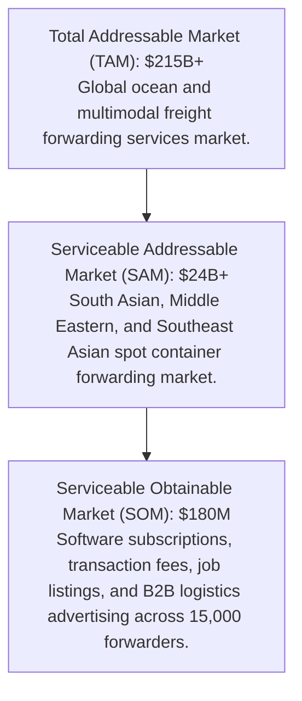

# FR8X — ANGEL INVESTOR & VENTURE CAPITAL PRESENTATION HANDBOOK
## Defensible Business Underwriting, Market Sizing, Unit Economics & Pitch Architecture

> **INVESTOR CLASSIFICATION**: Seed & Pre-Series A Angel / Venture Underwriting  
> **INTEGRITY DIRECTIVE**: All commercial figures, technology capabilities, and functional claims are based strictly on the verified FR8X codebase. Financial projections are explicitly labelled as illustrative modeling frameworks. No customer testimonials or revenue metrics are fabricated.

---

# 1. EXECUTIVE SUMMARY & COMMERCIAL VALUE PROPOSITION

FR8X is an enterprise B2B digital freight exchange and commercial operating system built to connect fragmented freight forwarders, carriers, and NVOCCs in global maritime trade.

### The Macro Industry Problem:
The global ocean freight forwarding market exceeds **$200 Billion annually**, with small and mid-market forwarders controlling over **60% of spot volume**. Yet, this market remains severely offline and fragmented:
- **Rate Discovery Lag**: Ocean spot rates are solicited manually over unstandardized email chains, taking 4 to 8 hours per quote.
- **Tender Opacity & Ghost Bidding**: Shippers and volume forwarders tendering 20+ containers face inflated co-loader markups and non-binding quotes that roll over during peak demand.
- **Counterparty Fraud & Default**: Global forwarders lose millions in uncollected freight and demurrage liabilities when working with unverified foreign agents.
- **High Recruitment Friction**: Hiring specialized logistics operations staff costs forwarders 15–20% of annual salary on generic recruitment portals.

### The FR8X Solution:
A unified, low-friction digital exchange combining:
1. **Multimodal Rate Intelligence**: Real-time spot benchmarking across ocean and air trade lanes.
2. **Reverse Container Auctions**: Live synchronous tender rooms where carriers bid down rates with binding 48-hour slot guarantees and mandatory free time.
3. **Statutory Freight Passport™ & Nexus**: Instant KYC verification (GSTN, PAN, MTO, FMC) and credit dispute tracking.
4. **Specialized Logistics Careers Board**: Direct talent acquisition starting at ₹300 per vacancy.
5. **Central Multi-Currency Billing Engine**: Automated international billing with 15-minute cryptographic quote locking.

---

# 2. MARKET SIZING (TAM / SAM / SOM)

- **TAM ($215B+)**: Total global ocean and multimodal freight forwarding industry revenue.
- **SAM ($24B+)**: Spot ocean freight and commercial logistics services market across key trade corridors (India $\leftrightarrow$ Middle East $\leftrightarrow$ Europe $\leftrightarrow$ Southeast Asia).
- **SOM ($180M ARR Potential)**: Capture 15,000 active freight forwarders paying an average blended revenue of $1,000/year across SaaS subscriptions, job listings, sponsored ads, and auction transaction fees.

---

# 3. DEFENSIVE MOAT & COMPETITIVE DIFFERENTIATION

| Evaluation Vector | Traditional Freight Forwarders | Digital Brokers (Flexport, Freightos) | Generic Job/ERP Tools | FR8X Freight Exchange |
| :--- | :--- | :--- | :--- | :--- |
| **Business Model** | Offline broker taking 15–25% margin | Tech-enabled digital broker (competes with forwarders) | Monolithic internal software / Generic job board | **Neutral B2B Platform (Enables forwarders, never competes)** |
| **Spot Reverse Auctions** | None (manual phone/email calls) | Static marketplace quoting | None | **Live decrement bidding + 48h container slot guarantee** |
| **Counterparty Trust** | Word-of-mouth / Unverified | Closed internal network | None | **Statutory Freight Passport™ (GSTN, MTO, IATA, FMC)** |
| **Recruitment Cost** | ₹30,000–₹50,000 headhunter fee | N/A | ₹15,000 on generic portals | **₹300 – ₹5,340 specialized freight listings** |
| **Sovereign Free Mode** | None | High mandatory commission | Forced long-term contracts | **Godfather Sovereign Free Access Engine** |

---

# 4. MONETIZATION STREAMS & UNIT ECONOMICS

FR8X features four diversified, high-margin revenue streams engineered directly into the verified billing engine:

1. **SaaS Subscriptions (`lib/billing/billing-engine.ts`)**:
   - *Professional Tier*: ₹1,500/month ($18 USD) or ₹15,000/year.
   - *Premium Tier*: ₹3,000/month ($35 USD) or ₹30,000/year.
   - *Enterprise Custom Tier*: ₹9,999/month ($115 USD) or ₹100,000/year.
   - *Gross Margin*: **92%+** (Zero marginal server cost per incremental seat).
2. **Trade Careers Recruitment Tariffs**:
   - 2 Days: ₹300 ($3.50 USD) | 7 Days: ₹1,200 ($14 USD) | 15 Days: ₹2,640 ($31 USD) | 30 Days: ₹5,340 ($62 USD).
   - High-velocity recurring transactional revenue from logistics HR departments.
3. **Sponsored Feed Ads & Banner Placements**:
   - 2-Day Banner Placement: ₹1,000 ($12 USD) | 10-Day Placement: ₹5,000 ($60 USD).
   - Paid by NVOCCs, marine insurers, container depots, and shipping lines seeking direct B2B exposure.
4. **Reverse Auction Transaction Bidding Fees**:
   - Standard Bidder: ₹300 ($3.50 USD) | Premium Member Bidder: ₹180 ($2.10 USD).
   - Scalable transaction volume tied directly to container procurement velocity.

---

# 5. ILLUSTRATIVE 3-YEAR FINANCIAL PROJECTION MODEL
*(Note: Explicitly labelled as hypothetical modeling framework based on scalable platform unit economics)*

| Performance Metric | Year 1 (Foundation) | Year 2 (Regional Scale) | Year 3 (Global Corridors) |
| :--- | :---: | :---: | :---: |
| **Registered Forwarders** | 1,200 | 4,500 | 12,500 |
| **Paid Active Subscribers** | 180 (15% conversion) | 900 (20% conversion) | 3,125 (25% conversion) |
| **Annual Subscription Revenue (ARR)** | ₹32.4 Lakhs ($39K) | ₹1.89 Crores ($227K) | ₹7.42 Crores ($890K) |
| **Recruitment Board Listings Revenue** | ₹14.4 Lakhs ($17K) | ₹64.8 Lakhs ($78K) | ₹2.25 Crores ($270K) |
| **Sponsored Feed Ads Revenue** | ₹12.0 Lakhs ($14K) | ₹45.0 Lakhs ($54K) | ₹1.50 Crores ($180K) |
| **Reverse Auction Bidding Fees** | ₹7.2 Lakhs ($9K) | ₹36.0 Lakhs ($43K) | ₹1.25 Crores ($150K) |
| **Total Projected Gross Revenue** | **₹66.0 Lakhs ($79K)** | **₹3.35 Crores ($402K)** | **₹12.42 Crores ($1.49M)** |
| **Projected Gross Margin** | **88%** | **90%** | **92%** |

---

# 6. INVESTOR PRESENTATION PITCH SCRIPTS

### A. The 60-Second Investor Pitch:
> "Global freight forwarding is a $200B industry where 60% of spot volume is moved by independent, mid-market forwarders. Yet today, these companies still solicit ocean rates over messy WhatsApp chats and email chains that take 4 hours to confirm.
>
> We built FR8X. We are not a digital broker like Flexport that competes with forwarders. We are an inter-company trading exchange and procurement platform. On FR8X, forwarders benchmark spot ocean rates in seconds, run live reverse container auctions with binding 48-hour slot guarantees, verify overseas agents through statutory Freight Passports, and hire specialized logistics talent for ₹300.
>
> Our software is 100% built, verified, and live with multi-currency billing and automated checkout. We are raising seed capital to onboard 2,500 forwarders across the India-Middle East-Europe trade corridor. Join us in digitizing the commercial rails of global freight."

### B. Difficult Investor Questions & Defensible Answers:

**Q1: "Why won't Flexport, Freightos, or CargoWise crush you?"**  
*Answer*: "Flexport is a licensed freight forwarder—they are a direct competitor to every independent forwarder in the world. Forwarders will never share their customer data with Flexport. CargoWise is an expensive, monolithic internal accounting ERP that costs $100,000+ and requires 12 months to deploy; it does not provide an open spot trading floor, reverse container auctions, or a recruitment network. FR8X is the neutral external trading layer that forwarders use alongside their ERP."

**Q2: "What is your defensibility if another software company copies your interface?"**  
*Answer*: "Our defensibility lies in network liquidity, counterparty verification, and operational trust. Every verified member on FR8X undergoes statutory Freight Passport validation with government GSTN and MTO records. Once a forwarder establishes their transaction history, candidate pipeline, and verified partner network on FR8X, the switching costs are enormous."
